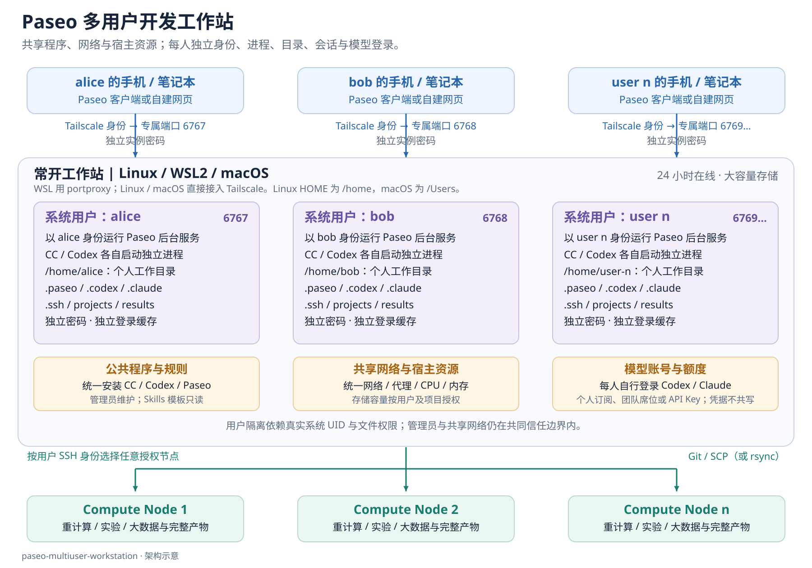
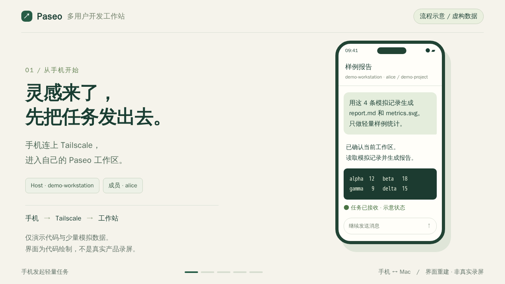

# Paseo Desk

基于 Paseo 与 Tailscale 的多用户 AI 开发工作台。

把一台常开的电脑（Windows + WSL2、原生 Linux 或 macOS）变成小团队共用的 AI 编程入口：每位成员用手机或笔记本，经 [Tailscale](https://tailscale.com) 连接到**自己的** [Paseo](https://paseo.sh) 实例，驱动 Claude Code / Codex 写代码；训练、推理等重计算通过各自的 SSH 身份提交到远程计算节点。



## 30 秒看懂手机与 Mac 如何接续

[](docs/demo/paseo-phone-mac.mp4)

[播放 / 下载短片](docs/demo/paseo-phone-mac.mp4) · [离线交互演示](docs/demo/index.html) · [分镜与制作说明](docs/demo/README.md)。画面由代码重建，账号、主机、路径、指标和用量均为虚构示例。

固定链路（macOS 使用每用户 LaunchDaemon）：

```text
手机 / 笔记本（Paseo 客户端或网页）
        │ Tailscale：按成员身份授权到专属端口
工作站：每个系统用户一个 Paseo 服务，独立端口与连接密码
        │ 以该用户 UID 运行 Claude Code / Codex（公共安装，经包装脚本启动）
        │ 每人自己的 ~/.ssh 配置
计算节点：数据、模型、实验与完整产物
```

## 共享什么、独立什么

| 对象 | 安排 | 边界 |
| --- | --- | --- |
| Node / Paseo / Claude Code / Codex 程序 | 公共安装，root 维护 | 普通用户只读执行 |
| Paseo、Claude Code、Codex 进程 | 每人独立 | systemd / launchd 以真实 UID 运行 |
| 项目、会话、配置、SSH 密钥 | 每人独立 | 私有 HOME（700），凭据文件 600 |
| Paseo 连接密码 | 每人独立 | 随机生成，仅本人 `~/.paseo/client.env` 可读 |
| 模型账号登录 | 每人独立 | 本人执行 `claude auth login` / `codex login`，不复制他人凭据 |
| 网络、代理、CPU、内存、磁盘 | 宿主共享 | 需要时再加每用户资源上限 |

隔离依靠系统 UID 与文件权限，**适合相互信任的小团队**：root/sudo 管理员、宿主管理员、共享网络都在共同信任边界内。它不是面向恶意租户的容器或虚拟机隔离。

## 仓库内容

```text
linux/                 工作站公共部分（root 安装）
  install.sh           安装包装脚本、systemd 模板、管理工具；可选下载 Node、npm 安装三个程序
  workstation.conf.example
  bin/                 claude、codex、paseo 公共入口（启动前检查 + 原样传参）
  sbin/paseo-user      add / reset-password / remove / list 每用户实例
  systemd/paseo@.service
  share/               工作站使用约定 + 写入各用户 CLAUDE.md / AGENTS.md 的同步脚本
windows/               Tailscale 在 Windows、Paseo 在 WSL 时的入口转发与常驻任务
macos/                 macOS 每用户实例的 launchd 模板
optional/egress-proxy/ 可选：全用户透明出口网关（mihomo TUN + nftables 防直连）
templates/             SSH 配置、Tailscale ACL、成员交付单模板
skills/remote-compute/ 远程计算任务的 Agent Skill 模板
docs/                  设计方案、管理员部署、成员教程、验收清单、故障排查
tests/                 不依赖真实用户、服务或模型的安装与运行回归检查
```

## 快速开始

1. 阅读 [设计方案](docs/design.md)，确认适用场景与信任边界；按 [宿主平台对照](docs/platforms.md) 选择部署路线。
2. Linux / WSL 管理员按 [部署指南](docs/admin-guide.md) 安装公共部分并创建成员（macOS 按平台文档配置 launchd）：
   ```bash
   git clone https://github.com/SuperFCR/paseo-desk.git
   cd paseo-desk
   sudo ./linux/install.sh --install-node 24.22.1 --install-packages   # 版本号按需选择
   sudo paseo-user add alice 6767
   sudo paseo-user add bob 6768
   ```
3. WSL 部署在 Windows 侧注册常驻任务（自动维护 Tailscale 入口转发）；原生 Linux / macOS 直接让 Paseo 监听本机 Tailscale 地址（macOS 用 launchd 托管实例，见平台文档）。
4. 按 [验收清单](docs/acceptance-checklist.md) 逐项验证后，用 [交付单模板](templates/handover.md) 私下把连接参数交给成员。
5. 成员阅读 [使用教程](docs/user-guide.md)。

## 文档

- [设计方案](docs/design.md)：隔离边界、任务流、用量统计、分阶段上线
- [按宿主平台部署](docs/platforms.md)：Windows + WSL2 / 原生 Linux / macOS 的差异与完整步骤
- [管理员部署指南](docs/admin-guide.md)：安装、新增/停用用户、Windows 转发、Tailscale 授权、常驻运行
- [成员使用教程](docs/user-guide.md)：连接、首个任务、远程计算、结果拉回、网页隧道
- [iPhone：Shadowrocket 内置 Tailscale](docs/ios-shadowrocket.md)：可选入网方式、成员身份、密钥用途与排错（待实机验收）
- [验收清单](docs/acceptance-checklist.md)
- [故障排查](docs/troubleshooting.md)
- [可选：出口网关模块](docs/egress-proxy.md)
- [验证记录与本地检查](docs/validation.md)
- [参与开发](CONTRIBUTING.md)

## 已验证环境

参考部署运行在 Windows + WSL2；本仓库脚本有静态检查和临时目录中的模拟测试，尚未从空白系统完成整套部署验收。原生 Linux / macOS 均待实机验收，详见[验证记录](docs/validation.md)和[平台对照](docs/platforms.md)。

参考版本：Paseo 0.13.2、Node 24、Codex 0.164、Claude Code 2.1.308，Windows 11 + WSL2（Ubuntu，systemd 启用，NAT 网络模式）+ Windows 版 Tailscale。安装器默认固定 Paseo 0.13.2（`PW_PASEO_VERSION`），因为 `paseo-user` 生成密码哈希时使用了内部模块路径。升级后须重新验证；若路径变化，可改由成员在本人终端执行 `paseo daemon set-password`。

## 使用须知

- 每位成员应使用自己有权使用的模型账号（个人订阅、团队/企业席位或 API Key），并遵守 Anthropic、OpenAI 等服务商的使用条款。本项目不提供、也不鼓励共享登录凭据。
- 可选出口网关模块只是通用的网络出口控制工具；使用者须自行确保符合所在地法律法规及服务商条款（包括其支持地区政策）。
- 本项目与 Paseo、Tailscale、Anthropic、OpenAI 均无隶属关系。

## 许可证

[MIT](LICENSE)
